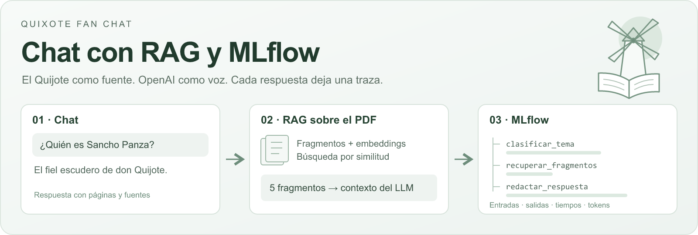
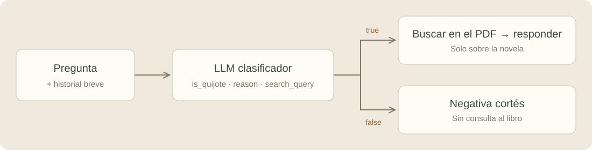
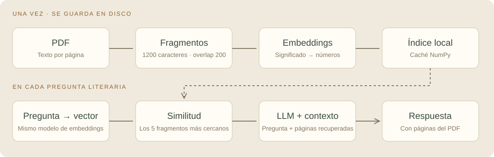
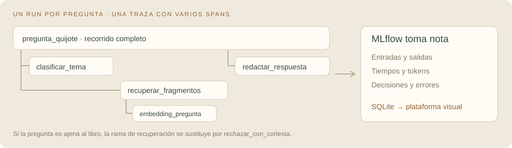

# Quixote Fan Chat

Un chatbot minimalista sobre **El Quijote** para aprender **RAG y observabilidad con MLflow** siguiendo un ejemplo completo: pregunta, clasificación, búsqueda en un PDF y respuesta con fuentes.

[](https://github.com/oscarfr96/quixote-fanchat/actions/workflows/tests.yml)

- **Chat:** consulta el libro, muestra las páginas utilizadas y rechaza con cortesía del Siglo de Oro las preguntas ajenas a la novela.
- **Observabilidad:** compara latencias y tokens, revisa decisiones y abre la plataforma MLflow.
- **Cómo funciona:** diagramas y ejemplos leídos del código real de la aplicación.

**Tecnologías:** Python · Streamlit · OpenAI · splitter de LangChain · NumPy · MLflow · SQLite.

## Instalar y arrancar

Necesitas **Python 3.12 o 3.13**, Git y una **clave de la API de OpenAI con saldo y acceso al modelo elegido**. El PDF de la demo está incluido. MLflow se ejecuta en tu ordenador y no requiere una cuenta adicional.

### 1. Clona e instala

**Windows · PowerShell**

```powershell
git clone https://github.com/oscarfr96/quixote-fanchat.git
cd quixote-fanchat
py -3.12 -m venv .venv
.\.venv\Scripts\python.exe -m pip install -r requirements.txt
if (!(Test-Path .env)) { Copy-Item .env.example .env }
```

**macOS / Linux**

```bash
git clone https://github.com/oscarfr96/quixote-fanchat.git
cd quixote-fanchat
python3.12 -m venv .venv
.venv/bin/python -m pip install -r requirements.txt
test -f .env || cp .env.example .env
```

Puedes sustituir Python 3.12 por 3.13. No hace falta activar el entorno: las órdenes usan directamente su intérprete.

<details>
<summary>Instalación alternativa con uv</summary>

Después de clonar el repositorio y entrar en su carpeta:

```bash
uv venv --python 3.12
uv pip install -r requirements.txt
```

Copia `.env.example` como `.env` si aún no existe y continúa con el siguiente paso.

</details>

### 2. Configura tu clave

Edita el archivo `.env` local:

```dotenv
OPENAI_API_KEY=tu_clave_privada
OPENAI_API_MODEL=gpt-6-luna
OPENAI_EMBEDDING_MODEL=text-embedding-3-small
```

El modelo de chat debe admitir **Responses API y Structured Outputs**. Puedes cambiarlo por otro compatible al que tenga acceso tu cuenta. El modelo de embeddings representa textos como vectores y se configura por separado.

Las variables de entorno del proceso tienen prioridad sobre `.env`. Reinicia la aplicación después de cambiar la configuración. **Tu clave no debe subirse a GitHub**: `.env` está excluido mediante `.gitignore`.

### 3. Arranca los dos servicios

Windows:

```powershell
.\.venv\Scripts\python.exe run.py
```

macOS / Linux:

```bash
.venv/bin/python run.py
```

El lanzador prepara MLflow, inicia ambos servicios y abre el navegador:

| Servicio | Dirección |
| --- | --- |
| Chat, Observabilidad y Cómo funciona | [http://127.0.0.1:8501](http://127.0.0.1:8501) |
| Plataforma MLflow | [http://127.0.0.1:5000](http://127.0.0.1:5000) |

Mantén la terminal abierta. **Ctrl+C detiene ambos servicios**. Puedes añadir `--no-browser` para evitar que se abra una ventana automáticamente.

## Prueba la demo en dos minutos

1. Pregunta **«¿Por qué confunde don Quijote los molinos con gigantes?»**. Verás el aviso de lectura, la respuesta y sus fuentes.
2. Pregunta **«¿Y cómo se llama su caballo?»**. El historial breve ayuda a resolver la referencia a don Quijote.
3. Pregunta **«¿Cómo preparo una tortilla?»**. La app responde con una negativa cortés y omite la búsqueda en el PDF.
4. Abre **Observabilidad → Actualizar**. Compara las rutas, los tiempos y los tokens de tus preguntas.
5. Abre la plataforma **MLflow**, selecciona el experimento **`quixote-fanchat`** y entra en **Traces**. Abre una traza y selecciona sus spans para ver entradas, salidas y duraciones.

La primera consulta literaria prepara el índice completo y tarda más. **Las llamadas a OpenAI, incluidos los embeddings, consumen saldo de tu API.** Las siguientes consultas reutilizan los embeddings del libro.

## Cómo funciona

### 1. Un LLM clasifica la pregunta



El modelo recibe instrucciones, la pregunta y hasta seis mensajes anteriores. Devuelve una salida estructurada definida con Pydantic:

```python
class TopicDecision(BaseModel):
    is_quijote: bool
    reason: str
    search_query: str
```

Por ejemplo, «¿Quién es Sancho?» puede producir `is_quijote=true` aunque no mencione el título. Una pregunta sobre cocinar debe producir `false`. `search_query` reformula una pregunta contextual como «¿y su caballo?» en una búsqueda autónoma.

Python utiliza `decision.is_quijote` para elegir la rama. La negativa es un texto fijo en castellano de sabor áureo. El esquema asegura la estructura de la salida; la clasificación sigue pudiendo equivocarse.

Código: [instrucciones](quixote/prompts.py) · [clasificación y ramas](quixote/bot.py).

### 2. El RAG recupera fragmentos del libro



**Al preparar el índice:** `pypdf` extrae el texto de cada página. El splitter de LangChain crea fragmentos de hasta **1200 caracteres**, con **200 de solapamiento** dentro de cada página. Cada fragmento conserva su página de origen. OpenAI calcula sus embeddings y NumPy guarda el índice en disco.

**Para cada pregunta aceptada:** calculamos el embedding de la consulta con el mismo modelo, comparamos su similitud con los vectores del libro y seleccionamos **cinco fragmentos**:

```python
# Los vectores están normalizados: el producto calcula similitud del coseno.
scores = index.vectors @ query_vector
positions = np.argsort(scores)[-settings.top_k:][::-1]
```

El LLM recibe **pregunta + historial + fragmentos recuperados** y redacta la respuesta señalando las páginas utilizadas. Si declara que falta evidencia o cita páginas ajenas al contexto, mostramos una respuesta de falta de evidencia.

El índice local es un archivo `.npz` que contiene vectores, textos y páginas. Se reutiliza tras reiniciar. Su nombre depende del PDF, el modelo de embeddings y la configuración de fragmentos. Las preguntas calculan su propio embedding en cada consulta aceptada; no tenemos una caché de preguntas.

El PDF se entrega como contexto al responder: **no entrenamos ni modificamos los parámetros del LLM**. Para este tamaño usamos búsqueda exacta con NumPy. Se podría sustituir el almacenamiento y la recuperación por una base vectorial como Chroma conservando el resto del flujo.

Código: [PDF, embeddings y recuperación](quixote/rag.py) · [generación y comprobación de páginas](quixote/bot.py).

### 3. MLflow observa el recorrido



| Concepto | En esta aplicación |
| --- | --- |
| **Experimento** | `quixote-fanchat`, agrupa todas las pruebas. |
| **Run** | Una ejecución por pregunta; otro run registra la preparación del índice. |
| **Traza** | El recorrido de una pregunta, asociado a su run. |
| **Span** | Un paso: clasificar, recuperar, crear un embedding o redactar. |
| **Parámetros** | Modelo, modelo de embeddings, `top_k` y tamaños de fragmento. |
| **Métricas** | Tiempo total y por paso, tokens, fragmentos y errores. |
| **Etiquetas** | Ruta `rag`/`rechazo`, motivo de clasificación e identificador de sesión. |

La instrumentación está escrita explícitamente en el código:

```python
with mlflow.start_span(name="clasificar_tema", span_type="LLM") as span:
    span.set_inputs({"question": question, "history": history})
    # Aquí se ejecuta la llamada al modelo.
    span.set_outputs(decision.model_dump())
```

El contexto de los spans conserva sus relaciones. Una consulta literaria genera este árbol:

```text
pregunta_quijote
├── clasificar_tema
├── recuperar_fragmentos
│   └── embedding_pregunta
└── redactar_respuesta
```

Una pregunta fuera de tema termina en `rechazar_con_cortesia`. Los errores marcan el run y los spans afectados como fallidos. Un bloque `finally` registra las métricas disponibles incluso si algo falla.

Los **tokens del LLM** suman clasificación y generación. Los **tokens de embeddings** de la pregunta y los del libro se registran aparte. La duración de un span padre incluye la de sus hijos: no sumes ambos como pasos independientes. El coste que pueda estimar MLflow es orientativo y no sustituye la facturación de OpenAI.

Código: [configuración y tokens](quixote/telemetry.py) · [run y traza principal](quixote/bot.py).

## Conversaciones y datos locales

**Nueva charla** vacía el chat visible y crea otra sesión. Las siguientes preguntas se procesan sin el historial anterior. Los registros de MLflow y el índice del PDF se conservan.

La interfaz no ofrece una lista de chats antiguos para reabrirlos. Puedes consultar las preguntas y respuestas registradas en Observabilidad o verlas agrupadas en **MLflow → Sessions**.

```text
.runtime/
├── index/          # Embeddings, fragmentos y páginas del libro
├── mlflow.db       # Runs, métricas y trazas en SQLite
├── artifacts/      # Artefactos locales de MLflow
├── mlflow.log
└── streamlit.log
```

Todo `.runtime/`, `.env` y el entorno virtual están excluidos de Git. La aplicación y el servidor MLflow usan la misma ruta absoluta de SQLite, aunque ejecutes el lanzador desde otra carpeta. Las preguntas, las respuestas y los fragmentos utilizados se envían a OpenAI durante las llamadas; las trazas de esta demo se guardan localmente.

## Estructura del proyecto

```text
app.py                 # Navegación de las tres pantallas
run.py                 # Arranque y cierre de Streamlit y MLflow
quixote/
├── config.py          # Configuración y rutas
├── prompts.py         # Instrucciones, negativa y aviso de lectura
├── bot.py             # Clasificador, ramas, respuesta y traza principal
├── rag.py             # PDF, caché de embeddings y similitud
├── telemetry.py       # MLflow y métricas de uso
├── provider.py        # Errores comprensibles de la API
└── ui.py              # Chat, observabilidad y recorrido didáctico
assets/                # PDF, cabecera y diagramas
tests/                 # Pruebas sin llamadas a OpenAI
```

Usamos el splitter de LangChain. El resto del flujo se mantiene explícito con el SDK de OpenAI y NumPy. Un grafo de LangGraph sería una ampliación posible; para estas dos ramas basta un `if`.

## Pruebas

Instala pytest y ejecuta la suite con el Python del entorno.

Windows:

```powershell
.\.venv\Scripts\python.exe -m pip install pytest
.\.venv\Scripts\python.exe -m pytest -q
```

macOS / Linux:

```bash
.venv/bin/python -m pip install pytest
.venv/bin/python -m pytest -q
```

Si instalaste con uv, añade pytest con `uv pip install pytest` y usa la orden de ejecución correspondiente a tu sistema.

Las pruebas simulan OpenAI y utilizan un PDF temporal: verifican rechazo, historial, fuentes, tokens y trazas persistidos, caché del índice, fallos, renderizado de las páginas y cierre de procesos. No necesitan clave ni consumen saldo. GitHub Actions ejecuta la suite en Windows y Linux.

## Problemas frecuentes

| Síntoma | Qué comprobar |
| --- | --- |
| Puerto 5000 o 8501 ocupado | Detén la instancia anterior con Ctrl+C desde su terminal y vuelve a arrancar. |
| OpenAI rechaza la clave o el modelo | Revisa `.env`, el saldo y el acceso al modelo. Reinicia tras cambiar la configuración. |
| La primera consulta tarda más | Se están calculando los embeddings del libro; después se reutilizan. |
| Cambios de código o configuración que no aparecen | Reinicia la app y recarga el navegador. |
| Falta el libro | Coloca un PDF con capa de texto en `assets/quijote.pdf` y reinicia. |
| Necesitas investigar un error | Revisa el run fallido en MLflow y los logs locales de `.runtime/`. |

## Alcance y créditos

Es una demo educativa local. El clasificador puede equivocarse, la recuperación puede traer contexto insuficiente y las respuestas requieren revisión. **OK** en una traza significa que terminó sin errores técnicos. La similitud y `grounded_answer` no verifican automáticamente la veracidad. Esta versión no incluye OCR, autenticación ni una evaluación automática de calidad.

El código y las ilustraciones originales del proyecto se distribuyen bajo [licencia MIT](LICENSE). El PDF es un recurso independiente: conserva los créditos de la compilación de **Carlos Valencia, 23 de diciembre de 2004**, basada en el texto del Centro Virtual Cervantes. Su procedencia se documenta en [NOTICE.md](NOTICE.md).

## Documentación oficial

- [OpenAI: Structured Outputs](https://developers.openai.com/api/docs/guides/structured-outputs)
- [OpenAI: embeddings](https://developers.openai.com/api/docs/guides/embeddings)
- [MLflow: trazas manuales](https://mlflow.org/docs/latest/genai/tracing/app-instrumentation/manual-tracing/)
- [MLflow: almacenamiento](https://mlflow.org/docs/latest/self-hosting/architecture/backend-store/)
- [Streamlit: páginas y navegación](https://docs.streamlit.io/develop/concepts/multipage-apps/page-and-navigation)
